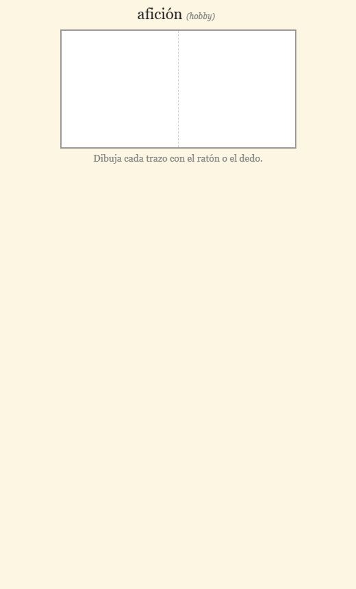
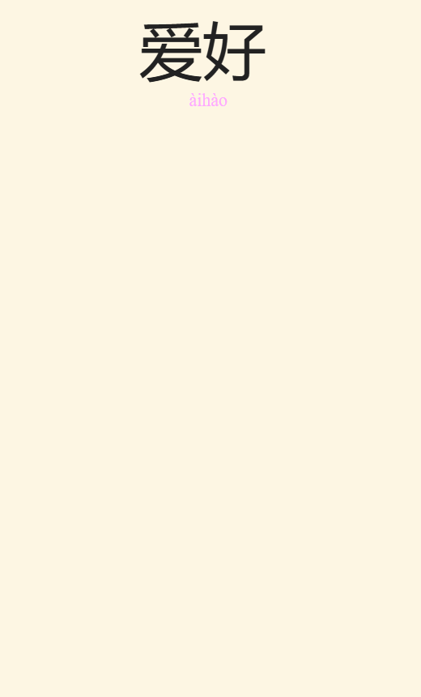
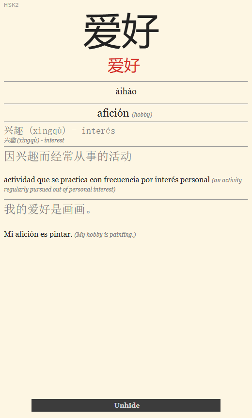
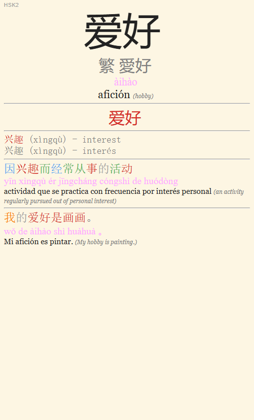

# Zhongwen Anki: vocabulario del HSK 3.0 en español

Mazos de Anki con el vocabulario del **nuevo HSK 3.0, niveles 1 a 4 (1.995 palabras)**, pensados para **hispanohablantes**. Cada palabra trae hanzi, pinyin, significado en español (con el inglés de apoyo), una frase de ejemplo, sinónimos y una definición breve en chino, con los caracteres coloreados por tono. Hay tarjetas para leer, para escribir el pinyin y para dibujar los caracteres trazo a trazo.

> **Not a Spanish speaker?** Every word also has its meaning, example sentence, synonyms and definition in English, so the decks can be adapted to any language. See [Adapting it to another language](#adaptarlo-a-otro-idioma--adapting-it-to-another-language).

Para estudiar solo hace falta [Anki](https://apps.ankiweb.net/).

| Significado → dibujar hanzi | Hanzi + pinyin → significado | Hanzi → escribir pinyin | Consulta |
|---|---|---|---|
|  |  |  |  |

## Descargas

| Nivel | Palabras | Mazo | Nombre del mazo en Anki |
|---|---|---|---|
| HSK1 | 301 | [`decks/HSK1.apkg`](decks/HSK1.apkg) | `Chino - HSK1 (HSK 3.0)` |
| HSK2 | 198 | [`decks/HSK2.apkg`](decks/HSK2.apkg) | `Chino - HSK2 (HSK 3.0)` |
| HSK3 | 499 | [`decks/HSK3.apkg`](decks/HSK3.apkg) | `Chino - HSK3 (HSK 3.0)` |
| HSK4 | 997 | [`decks/HSK4.apkg`](decks/HSK4.apkg) | `Chino - HSK4 (HSK 3.0)` |

Cada nivel contiene solo sus palabras **nuevas**, así que puedes importar varios. Si un carácter aparece en dos niveles, es con otra lectura o acepción (还 *hái* / *huán*, 站 «parada» / «estar de pie»). En las respuestas de HSK2 a HSK4 aparece, arriba a la izquierda, el nivel de la palabra.

## Empezar a estudiar

1. Instala [Anki](https://apps.ankiweb.net/) (Windows, macOS, Linux, Android, iOS). Para sincronizar el móvil, crea una cuenta de AnkiWeb.
2. Descarga los `.apkg` de la tabla (en cada enlace, botón de descarga) e impórtalos en Anki Desktop: `Archivo > Importar`.
3. Crea los mazos filtrados del [itinerario recomendado](#itinerario-recomendado-mazos-filtrados) y estudia desde ellos.

### Tipos de tarjeta

Cada palabra genera diez tarjetas. El código dice qué se muestra y qué se pide: `H` es hanzi, `P` pinyin y `M` significado (*meaning*). Lo que va antes del `2` se muestra; lo que va después, se pide.

| Código | Se muestra | Se pide |
|---|---|---|
| `H2M` | Hanzi | Recordar el significado |
| `M2H` | Significado | **Dibujar** el hanzi |
| `H2P` | Hanzi | **Escribir** el pinyin |
| `PM2H` | Pinyin + significado | **Dibujar** el hanzi |
| `P2M` | Pinyin | Recordar el significado |
| `M2P` | Significado | **Escribir** el pinyin |
| `P2H` | Pinyin | **Dibujar** el hanzi |
| `HM2P` | Hanzi + significado | **Escribir** el pinyin |
| `HP2M` | Hanzi + pinyin | Recordar el significado |
| `Toda la información` | Todo | Nada: es para consultar |

- **Dibujar:** un recuadro donde trazas el carácter con el ratón o el dedo. [HanziWriter](https://hanziwriter.org/) comprueba la forma, la dirección y el orden de cada trazo, y la respuesta anima el carácter correcto.
- **Escribir:** una caja de texto que acepta el pinyin con tildes (`àihào`) o con números (`ai4hao4`; tono neutro con `5`, `0` o sin número; `ü` como `ü`, `v` o `u:`). No importan las mayúsculas, los espacios ni los apóstrofos. La corrección marca los errores letra a letra en el formato que hayas usado.
- **Respuestas:** muestran además los sinónimos, una definición en chino y una frase de ejemplo. El botón **Unhide** muestra el pinyin de la definición y de la frase, para que intentes leerlas antes.

No hace falta estudiar las diez: elige las que te interesen.

## Itinerario recomendado: mazos filtrados

Los mazos `Chino - HSKn (HSK 3.0)` guardan las notas, pero no se estudian directamente. Se estudia desde **un mazo filtrado por cada tipo de tarjeta**: así cada habilidad lleva su propio ritmo y las palabras nuevas entran en lotes pequeños.

**1. Desactiva el estudio directo.** En las opciones de cada mazo `Chino - HSKn (HSK 3.0)`, pon **Tarjetas nuevas/día = 0** y **Repasos máximos/día = 0**.

**2. Crea un mazo filtrado por habilidad** (`Herramientas > Crear mazo filtrado`). Cada uno lleva **dos filtros**, y cada filtro su propia búsqueda. Este es el primero, para dibujar el hanzi a partir del pinyin y el significado:

- **Nombre:** `Hanzi ← pinyin y significado`
- **Filtro 1**, los repasos pendientes de **todos** los niveles:
  ```text
  deck:"Chino - HSK*" card:PM2H is:due
  ```
  Límite `9999`, orden **Orden de revisión** (*Order due*).
- **Filtro 2** (marca la casilla para activarlo), las tarjetas nuevas del nivel que estés estudiando:
  ```text
  deck:"Chino - HSK1 (HSK 3.0)" card:PM2H is:new
  ```
  Límite `10` a `15`, orden **Orden añadido** (*Order added*).
- Deja activado **Reprogramar tarjetas según mis respuestas**.

Las dos búsquedas llevan el mismo `card:` y se diferencian en dos cosas: el filtro 1 usa `HSK*` e `is:due`, y el filtro 2 usa el nivel concreto e `is:new`. Si al estudiar ves una tarjeta que no es del tipo del mazo (por ejemplo, sin recuadro de dibujo), a alguna búsqueda le falta el `card:`.

Los otros tres mazos son iguales, cambiando el código:

| Mazo filtrado | Filtro 1 (repasos) | Filtro 2 (nuevas) |
|---|---|---|
| `Hanzi ← pinyin y significado` | `deck:"Chino - HSK*" card:PM2H is:due` | `deck:"Chino - HSK1 (HSK 3.0)" card:PM2H is:new` |
| `Pinyin ← hanzi` | `deck:"Chino - HSK*" card:H2P is:due` | `deck:"Chino - HSK1 (HSK 3.0)" card:H2P is:new` |
| `Pinyin ← significado` | `deck:"Chino - HSK*" card:M2P is:due` | `deck:"Chino - HSK1 (HSK 3.0)" card:M2P is:new` |
| `Significado ← hanzi y pinyin` | `deck:"Chino - HSK*" card:HP2M is:due` | `deck:"Chino - HSK1 (HSK 3.0)" card:HP2M is:new` |

Las búsquedas para copiar y pegar están también en [`docs/tarjetas/template_mazos.txt`](docs/tarjetas/template_mazos.txt).

**3. Antes de cada sesión, pulsa Reconstruir** en cada mazo filtrado. Trae los repasos del día y el siguiente lote de nuevas.

**4. Cuando termines un nivel**, cambia `HSK1` por `HSK2` (y así sucesivamente) en el **filtro 2**. El filtro 1 no se toca: ya incluye todos los niveles.

Estos cuatro mazos cubren escribir los caracteres, producir el pinyin y entender el significado. Para entrenar otra dirección, crea otro mazo con el mismo patrón y su código (`M2H`, `P2H`, `H2M`...). `Toda la información` es para consultar: ábrela desde el explorador o con un mazo filtrado `card:"Toda la información"` con la reprogramación desactivada. Si alguna vez estudias desde los mazos principales, suspende esas tarjetas para que no aparezcan en los repasos.

Más trucos (barajar las nuevas, empezar de cero, ritmo por habilidad, AnkiDroid): [`docs/GUIA_ANKI.md`](docs/GUIA_ANKI.md).

## Actualizar un mazo ya importado

Vuelve a importar el `.apkg` nuevo. Cada palabra conserva su identificador (GUID), así que Anki actualiza las notas y mantiene tu progreso.

Si una versión **añade campos o tipos de tarjeta**, activa en el diálogo de importación **Merge note types** (fusionar tipos de nota; Anki 23.10 o posterior). Sin esa opción, Anki crea un segundo tipo de nota con un sufijo (`Chino - HSK (ES/EN)-xxxxx`) y no actualiza tus notas. Fusionar cambia la estructura de la colección, así que la siguiente sincronización con AnkiWeb será completa: sincroniza antes todos tus dispositivos y, después, elige **Subir a AnkiWeb**.

> **La versión 0.4.0 requiere *Merge note types*:** añade los tipos de tarjeta `P2H`, `HM2P`, `HP2M` y `Toda la información` y los campos `SourceLevel` y `PinyinNumbered`; `M2H` pasa a pedir dibujar el hanzi y `M2P` a pedir escribir el pinyin. El historial de repasos se conserva.

## Ajustes recomendados en Anki

<details>
<summary>Configuración de mazo que uso (ajústala a tu gusto)</summary>

```
# Límites diarios
Tarjetas nuevas/día = 5
Repasos máximos/día = 100

# Tarjetas nuevas
Pasos de aprendizaje = 1m 10m 1d 6d
Intervalo de graduación = 7
Intervalo fácil = 10
Orden de inserción = Aleatorio

# Fallos
Pasos de re-aprendizaje = 10m 20m
Intervalo mínimo = 2
Umbral de sanguijuela = 5
Acción de sanguijuela = Solo etiquetar

# Avanzado
Intervalo máximo = 365
Facilidad inicial = 2.50
Bonus fácil = 1.30
Modificador de intervalo = 1.10
Intervalo difícil = 1.20
Nuevo intervalo = 0.80
```
</details>

Complementos útiles: [Review Heatmap](https://ankiweb.net/shared/info/1771074083) (visualiza tu constancia) y [Auto Ease Factor](https://ankiweb.net/shared/info/1672712021) o [Reset Ease](https://ankiweb.net/shared/info/947935257) (evitan que la facilidad de las tarjetas caiga sin remedio).

## Analizar tu progreso

Dos comandos convierten tu historial de repasos en un informe HTML: precisión por tipo de tarjeta y por nivel, retención por intervalo, palabras y caracteres que más cuestan, combinaciones de tonos difíciles, tiempos de respuesta y recomendaciones de estudio.

```bash
zhongwen-anki-export-stats --vocab-dir data --card-snapshot
zhongwen-anki-analyze-stats --cards docs/local/estadisticas/anki_reviews.cards.csv
```

El primero lee la colección de Anki Desktop (cierra Anki antes, o cambia a otro perfil, porque Anki bloquea el que tiene abierto) y escribe un CSV en `docs/local/estadisticas/`. El segundo genera `docs/local/estadisticas/report.html`. Requieren la instalación de [Generar los mazos](#generar-o-ampliar-los-mazos). Si estudias en el móvil, sincroniza con AnkiWeb y luego en Anki Desktop, o exporta un `.colpkg` desde AnkiDroid y pásalo con `--collection`. Detalles en [`docs/GUIA_ANKI.md`](docs/GUIA_ANKI.md#analizar-tu-progreso).

## Adaptarlo a otro idioma / Adapting it to another language

Cada palabra de `data/hskN/input.tsv` tiene su significado, frase, sinónimos y definición también en inglés (`Meaning`, `SentenceMeaning`, `Synonyms`, `DictionaryMeaning`). Para otro idioma: añade esas columnas traducidas con su sufijo (`MeaningFR`, `SentenceMeaningFR`...), traduce los pocos textos fijos de `card_template/` y genera los mazos con `zhongwen-anki-build-all --target-lang FR`. Los pasos y un prompt para traducir con un LLM están en [`CONTRIBUTING.md`](CONTRIBUTING.md#otro-idioma-de-destino).

*Every word in `data/hskN/input.tsv` also has its meaning, example sentence, synonyms and definition in English. To adapt the decks to your language, add those columns translated with your language suffix (`MeaningFR`, `SentenceMeaningFR`...), translate the few fixed texts in `card_template/`, and build with `zhongwen-anki-build-all --target-lang FR`. Steps and an LLM translation prompt are in [`CONTRIBUTING.md`](CONTRIBUTING.md#otro-idioma-de-destino).*

## Generar o ampliar los mazos

Con Python 3.10 o superior:

```bash
git clone https://github.com/armcospa/ZHONGWEN-HSK3.0.git
cd ZHONGWEN-HSK3.0
python -m venv .venv
.venv\Scripts\activate       # Windows; en macOS/Linux: source .venv/bin/activate
pip install -e ".[deck,test]"

zhongwen-anki-build-all      # regenera data/*/output.tsv y decks/*.apkg
```

| Comando | Qué hace |
|---|---|
| `zhongwen-anki-build-all` | Regenera todos los niveles (o algunos, con `--levels HSK2 HSK3`) |
| `zhongwen-anki` | Enriquece un `input.tsv`: pinyin de frases y definiciones, coloreado por tono |
| `zhongwen-anki-build-deck` | Empaqueta un `output.tsv` en un `.apkg` |
| `zhongwen-anki-export-stats` | Exporta tu historial de repasos de Anki a CSV |
| `zhongwen-anki-analyze-stats` | Genera el informe HTML a partir de ese CSV |

El proyecto se usa desde el repositorio clonado (instalación editable): las plantillas y los datos viven fuera del paquete. Cómo funciona el pipeline, cómo añadir vocabulario o un nivel y cómo están organizadas las plantillas: [`CONTRIBUTING.md`](CONTRIBUTING.md).

## Créditos y licencia

- Listas de palabras del HSK 3.0; la fuente de cada nivel está en su `data/hskN/README.md`. Si encuentras un error en alguna palabra, abre un *issue*.
- Basado en [`zhongwen-anki`](https://github.com/thomashirtz/zhongwen-anki), de Thomas Hirtz (MIT).
- Las tarjetas de dibujo usan [HanziWriter](https://hanziwriter.org/), de David Chanind (MIT), con datos de trazos de [Make Me a Hanzi](https://github.com/skishore/makemeahanzi), de Shaunak Kishore, derivados de las fuentes Arphic (Arphic Public License). Ver [`vendor/hanzi-writer/NOTICE.md`](vendor/hanzi-writer/NOTICE.md).
- La segmentación y el pinyin de las frases usan [jieba](https://github.com/fxsjy/jieba) y [pypinyin](https://github.com/mozillazg/python-pinyin); los mazos se empaquetan con [genanki](https://github.com/kerrickstaley/genanki).
- Para crear listas de vocabulario mientras navegas es útil la extensión [Zhongwen](https://github.com/cschiller/zhongwen).

Distribuido bajo licencia MIT; ver [`LICENSE`](LICENSE).
